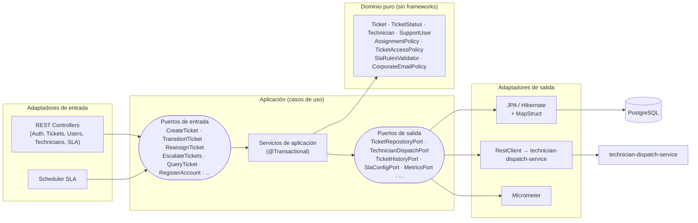
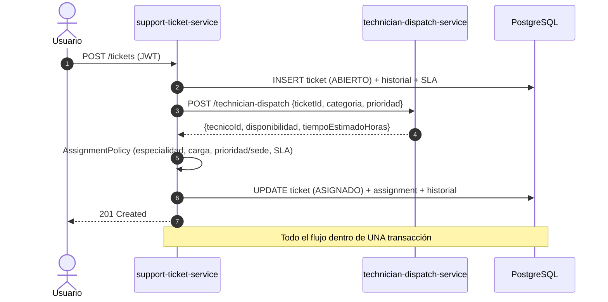
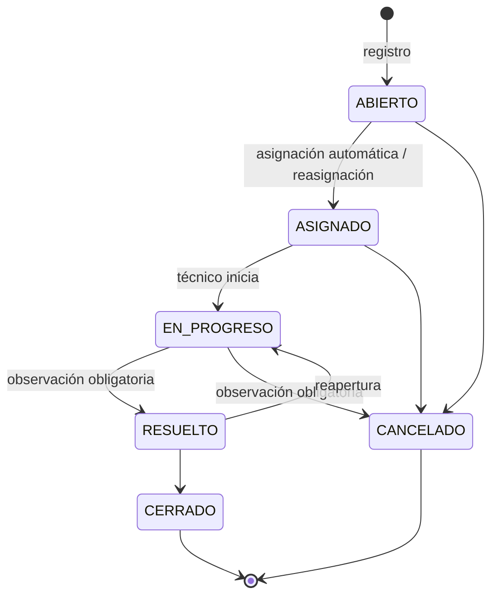

# HelpFlow – Sistema Integral de Gestión de Soporte TI

Prueba de Desempeño – Módulo 6 (Arquitectura Hexagonal + JPA avanzado + Seguridad JWT + Observabilidad + Microservicios + Docker + Pruebas).

Dos microservicios:

| Servicio | Puerto | Descripción |
|---|---|---|
| `support-ticket-service` | 8080 | Servicio central: usuarios, técnicos, tickets, SLA, seguridad JWT, métricas. Arquitectura hexagonal + PostgreSQL |
| `technician-dispatch-service` | 8081 | Servicio simulado y determinista de disponibilidad técnica. Liviano: sin JPA ni seguridad |

**Stack:** Java 21 · Spring Boot 3.4 · Spring Security + JJWT · Spring Data JPA/Hibernate · Flyway · PostgreSQL 16 · MapStruct · Micrometer/Actuator · springdoc (Swagger) · JUnit 5 + Mockito + Testcontainers · Docker.

---

## 1. Ejecución

### Con docker-compose (recomendado)
```bash
cp .env.example .env        # opcional: cambiar secretos
docker compose up --build
```
- Swagger UI: http://localhost:8080/swagger-ui.html
- Health: http://localhost:8080/actuator/health
- Dispatch: `POST http://localhost:8081/technician-dispatch`

Se crea un **ADMIN inicial** (`admin@helpflow.com` / `Admin12345!`, configurable con `ADMIN_CORREO` / `ADMIN_PASSWORD`).

### Local (sin Docker para las apps)
```bash
docker compose up -d db                                   # solo PostgreSQL
cd technician-dispatch-service && mvn spring-boot:run     # terminal 1 (8081)
cd support-ticket-service      && mvn spring-boot:run     # terminal 2 (8080)
```
Variables: `DB_URL`, `DB_USER`, `DB_PASSWORD`, `DISPATCH_URL`, `JWT_SECRET` (≥ 32 caracteres), `JWT_EXPIRATION` (ISO-8601, p. ej. `PT1H`).

### Pruebas
```bash
cd technician-dispatch-service && mvn test
cd support-ticket-service      && mvn test      # requiere Docker (Testcontainers levanta PostgreSQL)
```

---

## 2. Arquitectura hexagonal



Estructura de `support-ticket-service`:

```
com.helpflow.ticket
├── domain/                 # Java puro: modelo, excepciones, políticas (sin Spring/JPA/Jackson)
├── application/
│   ├── port/in             # Casos de uso (interfaces + commands)
│   ├── port/out            # Puertos hacia persistencia, dispatch, métricas
│   └── service             # Implementaciones de casos de uso (@Transactional)
└── infrastructure/
    ├── adapter/in/rest     # Controllers, DTOs, validaciones Bean Validation, @ControllerAdvice, MapStruct
    ├── adapter/out/persistence  # Entidades JPA, repositorios, mappers MapStruct, adaptadores
    ├── adapter/out/dispatch     # Adaptador REST hacia technician-dispatch-service
    ├── adapter/out/metrics      # Adaptador Micrometer
    ├── security            # JWT, filtros, ProblemDetail 401/403, traceId
    └── config              # Composición de beans (UseCaseConfig), scheduler, OpenAPI
```

**Decisiones:**
- El **dominio no importa ningún framework**. Los casos de uso no tienen estereotipos (`@Service`): se ensamblan en `UseCaseConfig` inyectando solo puertos. La única anotación de framework en `application` es `@Transactional` (frontera transaccional del caso de uso).
- `technician-dispatch-service` es opcional para la asignación: si no responde (timeout 2 s / 3 s) se registra un `WARN` y se aplican las reglas locales.

---

## 3. Relación entre microservicios



---

## 4. Ciclo de vida del ticket



`ASIGNADO` solo se alcanza por asignación/reasignación (nunca por el endpoint de transiciones). La reasignación mantiene el ticket en `ASIGNADO` (si estaba `EN_PROGRESO`, vuelve a `ASIGNADO`).

---

## 5. Reglas de negocio

### Roles y permisos
| Rol | Permisos |
|---|---|
| `ROLE_USUARIO` | Crear tickets; consultar **solo los propios**; cancelar o cerrar los propios; editar su perfil |
| `ROLE_TECNICO` | Consultar y gestionar **solo los tickets asignados** (→ `EN_PROGRESO`, → `RESUELTO`) |
| `ROLE_ADMIN` | Acceso completo, reasignación, escalamiento manual, configuración de SLA, gestión de usuarios y técnicos |

- `/auth/register` es público **solo para rol USUARIO**. Crear cuentas `TECNICO`/`ADMIN` requiere un token de ADMIN (evita escalada de privilegios). Una cuenta TECNICO se vincula a un técnico existente (`codigoTecnico`).
- Correo corporativo: formato válido y **no** de proveedores públicos (gmail, hotmail, outlook, yahoo…). Documento y correo únicos. Usuario `ACTIVO` obligatorio para registrar tickets.
- Contraseñas con **BCrypt** (`PasswordEncoder`). JWT HS256 stateless (claims: `uid`, `tid`, `role`).

### SLA
Horas por defecto (tabla `sla_config`, editable por ADMIN en `PUT /sla`): **CRITICA 4h · ALTA 8h · MEDIA 24h · BAJA 72h**. `fechaLímite = creación + horas` (horas calendario).
Validación cruzada: una prioridad mayor nunca puede tener más horas que una menor (si no → `422`).

### Flujo de asignación (una sola transacción)
1. Se registra el ticket `ABIERTO` y su historial; se calcula `slaLimite`.
2. Se consulta `technician-dispatch-service` (adaptador REST con timeouts).
3. `AssignmentPolicy` evalúa candidatos **activos**:
   - **Compatibilidad**: `especialidad == categoría` (o técnico `OTRO` = generalista).
   - **Carga máxima**: tickets activos (`ASIGNADO` + `EN_PROGRESO`) < `cargaMaxima`.
   - **Prioridad y sede**: un ticket `CRITICA` prefiere un técnico de su misma sede si existe.
   - **SLA**: si el tiempo estimado > horas de SLA, el ticket se **marca en riesgo y se escala** de inmediato.
4. Si el técnico sugerido cumple las reglas se usa; si no, se elige el mejor candidato local (misma sede → menor carga → código).
5. Si nadie es elegible, el ticket queda `ABIERTO` con una entrada de historial para asignación manual.

### Escalamiento automático
`SlaEscalationScheduler` (cada 60 s, `helpflow.sla.escalation-interval-ms`) y `POST /tickets/escalamiento` (ADMIN): tickets con SLA corriendo que consumieron ≥ 80 % de su ventana (`helpflow.sla.escalation-threshold`) suben una prioridad, se marcan `escalado` y se deja historial. Un ticket se escala una sola vez.

---

## 6. Endpoints (`support-ticket-service`)

| Método | Ruta | Rol | Descripción |
|---|---|---|---|
| POST | `/auth/register` | público (USUARIO) / ADMIN (otros roles) | Registro |
| POST | `/auth/login` | público | Devuelve JWT |
| POST | `/tickets` | USUARIO, ADMIN | Crear + asignar |
| GET | `/tickets?estado=&page=&size=` | todos (filtrado por rol) | Listado paginado |
| GET | `/tickets/{id}` | dueño / técnico asignado / ADMIN | Detalle |
| GET | `/tickets/{id}/historial` | ídem | Trazabilidad |
| POST | `/tickets/{id}/transiciones` | según rol | Cambio de estado + observación |
| POST | `/tickets/{id}/reasignacion` | ADMIN | Reasignar técnico |
| POST | `/tickets/escalamiento` | ADMIN | Escalar por SLA |
| GET | `/users/me`, `/users/{id}` · PUT `/users/{id}` | propio / ADMIN | Perfil |
| GET `/users` · PATCH `/users/{id}/estado` | ADMIN | Gestión |
| POST/GET/PUT/PATCH | `/technicians[/{id}[/estado]]` | ADMIN | Gestión de técnicos |
| GET / PUT | `/sla` | autenticado / ADMIN | Configuración de SLA |
| GET | `/actuator/health`, `/info`, `/metrics`, `/prometheus` | público* | Observabilidad |

\* En producción deben exponerse en un puerto de gestión interno (`management.server.port`) o restringirse por red.

`technician-dispatch-service`: `POST /technician-dispatch` → `{ticketId, tecnicoId, disponibilidad, tiempoEstimadoHoras}`.
Determinista: `CRC32("ticketId|CATEGORIA|PRIORIDAD")` → técnico `TEC-001..TEC-020` y 0–12 h (0–2 ALTA, 3–8 MEDIA, >8 BAJA). Acepta `CRÍTICA` con tilde.

### Errores – ProblemDetail (RFC 7807)
Todas las respuestas de error (validación, dominio, JPA, 401, 403, 404, 405…) usan `application/problem+json`:
```json
{
  "type": "https://helpflow.com/problems/invalid-state-transition",
  "title": "Transición de estado inválida",
  "status": 409,
  "detail": "Transición no permitida: CERRADO → EN_PROGRESO. Permitidas desde CERRADO: []",
  "instance": "/tickets/12/transiciones",
  "timestamp": "2026-01-01T10:00:00Z",
  "traceId": "9d1c5a2e-..."
}
```
`traceId` también viaja en la cabecera `X-Trace-Id` y en cada línea de log.

| Situación | HTTP |
|---|---|
| Bean Validation / JSON ilegible | 400 (con lista `errors`) |
| Sin token / token inválido / credenciales | 401 |
| Rol o propiedad insuficiente | 403 |
| Recurso inexistente | 404 |
| Duplicado, transición inválida, concurrencia (`@Version`), integridad | 409 |
| Regla de negocio (usuario inactivo, técnico incompatible/sin cupo, SLA inconsistente) | 422 |

---

## 7. Persistencia

- Relaciones: `Usuario 1–N Ticket`, `Ticket 1–N Historial`, `Ticket N–1 Técnico`; todas `LAZY`.
- **N+1 evitado** con `@EntityGraph(user, technician)` en listados/detalle, `default_batch_fetch_size=20`, `join fetch` en login y una consulta agregada (`group by`) para la carga por técnico.
- Bloqueo optimista (`@Version`) en tickets. `open-in-view=false`. `ddl-auto=validate`.
- **Flyway:** `V1__schema`, `V2__asignaciones_historial_sla`, `V3__datos_iniciales` (20 técnicos `TEC-001..TEC-020` con especialidades y sedes rotativas).
- Asignar, reasignar, transicionar y escalar se ejecutan cada uno en un `@Transactional`.

## 8. Observabilidad

Métricas de negocio (`/actuator/metrics/<nombre>` y `/actuator/prometheus`):

| Métrica | Tipo | Significado |
|---|---|---|
| `helpflow.tickets.created{categoria,prioridad}` | counter | Tickets creados |
| `helpflow.tickets.escalated{prioridad}` | counter | Tickets escalados por SLA |
| `helpflow.tickets.first.response` | timer | Tiempo medio de primera respuesta (creación → `EN_PROGRESO`) |
| `helpflow.tickets.resolution` | timer | Tiempo medio de resolución |
| `helpflow.tickets.overdue` | gauge | Tickets activos con SLA vencido |
| `helpflow.auth.failures` | counter | Fallas de autenticación |
| `helpflow.access.denied` | counter | Accesos denegados |

Logging estructurado JSON (`logging.structured.format.console=logstash`, Spring Boot 3.4) con `traceId` en el MDC.

## 9. Calidad

- **Unitarias (JUnit + Mockito):** `TicketTest`, `AssignmentPolicyTest`, `PoliciesTest`, `CreateTicketServiceTest` (con mock de `TechnicianDispatchPort`), `TransitionAndEscalationTest`, y `DispatchServiceTest` / `DispatchControllerTest`.
- **Integración (Spring Boot Test + MockMvc + Testcontainers/PostgreSQL):** `SupportTicketApiTest` cubre registro, JWT, ProblemDetail, propiedad de tickets, flujo técnico completo, reasignación, SLA, escalamiento y métricas.

## 10. Entregables y evidencias
- Colección Postman: `postman/HelpFlow.postman_collection.json` · Swagger: `/swagger-ui.html`.
- Capturas de pruebas, métricas, tickets vencidos y logs: ver `docs/evidencias/README.md` (comandos para generarlas) y guardar las imágenes en esa carpeta.
