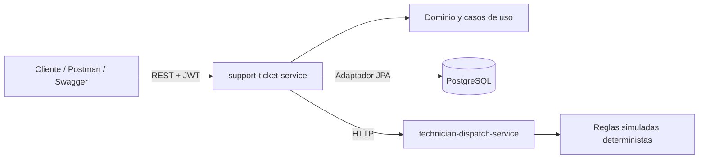

# Arquitectura general

`support-ticket-service` es el dueño de los tickets, usuarios, técnicos, historial y reglas de transición. `technician-dispatch-service` es stateless y simula una decisión de despacho.
